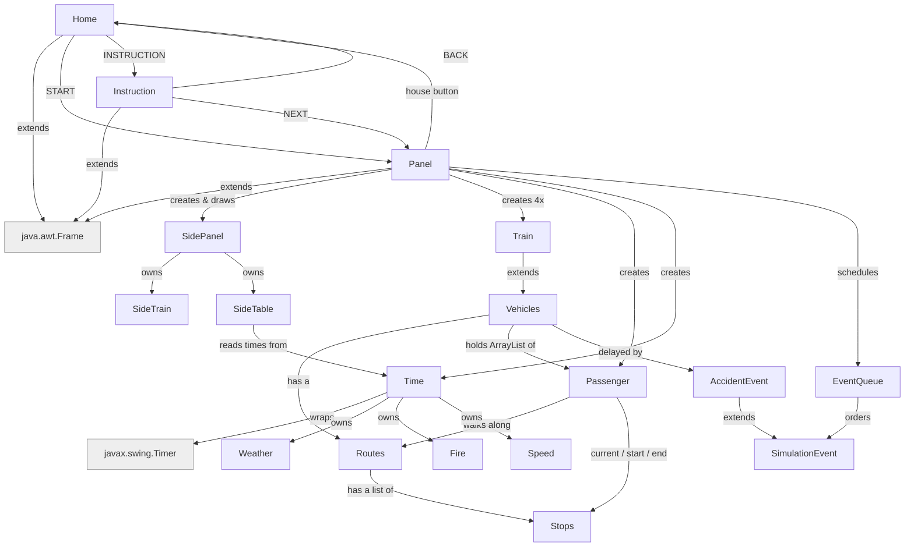
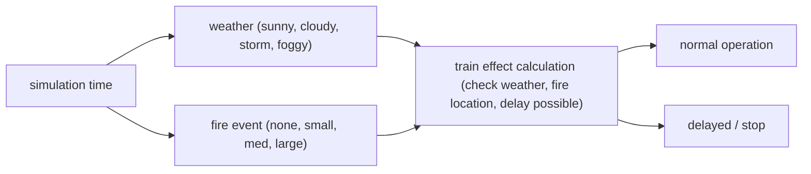

# comp2000-simulation project

COMP2000 S2 2026 Assignment 

Team: OOPP The GOOP: Ashton, Luke, Daniel, Minying, Amanda

## Project Goal

A small transit-network simulation: four trains, each on its own coloured
line, share a station network and carry passengers between stops. Random
accidents, weather and fires delay or stop trains, and the whole timetable runs
on a simulated 06:00 AM to midnight day, resuming automatically each morning.

## Getting Started

1. Run `Home.java`.
2. START opens the simulation directly; INSTRUCTION explains the controls
   first, then NEXT opens it.
3. Space, or the play button (top right), starts/pauses the clock. The house
   button (top right) returns to the home screen. The 1x / 2x / 4x buttons
   next to it set the simulation speed.
4. Trains run 06:00 AM – midnight; the clock keeps going overnight and
   service resumes automatically at 6am.

## Folder Structure

- src: the folder to maintain sources
- lib: the folder to maintain dependencies

## Classes

| Class | Role |
|---|---|
| `Home`, `Instruction`, `Panel` | the three screens (title, help, simulation); each `extends Frame` |
| `SidePanel` | top bar (clock, pause, house) and the tabs that switch views |
| `SideTrain` / `SideTable` | scrolling train-card list / timetable view |
| `Vehicles` → `Train` | a vehicle on a route; `Train` adds the `t1()`–`t4()` factories |
| `Routes`, `Stops` | one line's ordered stops; one station |
| `Passenger` | a commuter walking stop to stop |
| `Time` | simulated clock, 06:00–midnight service window, throws on the hour boundary |
| `SimulationEvent` → `AccidentEvent` | a scheduled effect; delays one named train |
| `EventQueue<T extends SimulationEvent>` | priority queue of due events, wraps `PriorityQueue<T>` |
| `Pair<T, U>`, `GenericUtil` | small generics: a label/value pair, a bounded `max(T, T)` |
| `SimulationTimeException` | custom checked exception for the service window |
| `HazardStripe`, `StopSign`, `Assets` | drawing helpers (delay border, stop sign); background-picture loader |
| `Speed` | the 1x / 2x / 4x setting; changes the timer delay in `Time` |
| `Weather`, `Fire` | the weather and fire rules (see below); both owned by `Time` |
| `DurationLimitException` | custom checked exception: a weather or fire asked to last too long |

## Weather and Fire

Weather and fire are two separate systems. Both follow the simulation clock,
so the 1x / 2x / 4x speed changes them too. Weather covers the whole map. A
fire is at one station and only affects trains at or heading into that station.

**Weather** (each spell lasts a random time, from 15 minutes up to its limit):

| Weather | Longest | Effect on trains | Look |
|---|---|---|---|
| Sunny | 4 hours | none | |
| Cloudy | 2 hours | 15% chance of a short delay | red/yellow stripe |
| Rain | 1 hour | 80% chance of a delay | red/yellow stripe |
| Foggy | 30 minutes | every train stops until it clears | stop sign |

**Fire** (30% chance of starting each time the weather changes):

| Fire | Longest | Effect on nearby trains | Look |
|---|---|---|---|
| Small | 1 hour | 20% chance of a delay | red/yellow stripe |
| Medium | 1 hour | 60% chance of a longer delay | red/yellow stripe |
| Large | 30 minutes | stops until the fire is out | stop sign |

**The rules that tie them together:**

1. A weather never follows itself, so no weather can run past its limit.
2. Rain and fog never follow each other. After one of them it is sunny or
   cloudy first.
3. No fire in rain or fog. When either starts, any burning fire is put out.
4. The time of day makes some weather more likely: fog at night, sunny or
   cloudy in the morning, sunny or rain in the afternoon.
5. A delayed train still moves after its delay ends. A stopped train does not
   move at all until the fog lifts or the fire is out.

The arrows show which weather can follow which; there is no arrow between
Rain and Foggy. Asking for a spell longer than its limit throws
`DurationLimitException`.

## Project Status

Status: DONE / PARTLY DONE / TODO

| Feature | Status | Note |
|---|---|---|
| Top bar | DONE | clock, date, pause, house button |
| Train list (SideTrain) | PARTLY DONE | no passenger-waiting count yet |
| Timetable (SideTable) | DONE | one row per train + "busiest right now" |
| Time | DONE | 06:00–midnight, ~5 sim-min/real-sec, random wobble |
| Accidents / delays | DONE | `EventQueue<AccidentEvent>`, hazard-stripe indicator |
| Speed control | DONE | 1x / 2x / 4x buttons, `Speed` |
| Day-night tint | DONE | map colour follows the time of day |
| Weather | DONE | sunny / cloudy / rain / fog, time limits, stop sign for fog |
| Fire | DONE | small / medium / large, never in rain or fog |
| Random passengers | PARTLY DONE | random start/end; no rush-hour spawn curve |
| Passenger types by colour | TODO | e.g. student/worker colour key |
| Exceptions | DONE | `SimulationTimeException`, `DurationLimitException`; image loads fall back instead of crashing |
| Home / Instruction screens | DONE | |
| Clickable stations | TODO | show waiting passengers, next train |

## Ideas for later

- More vehicle types (`Bus`, `Tram`) as further `Vehicles` subclasses.
- More `SimulationEvent` types (rush hour, scheduled arrival) once passenger spawning supports them.
- `RouteNotFoundException`, `TrainFullException`.
- Train capacity limits; `Stops.checkCapacity()` wired into boarding time.
- Statistics view (delivered / average wait / on-time %).
- Map zoom on scroll; click a line to highlight it; larger-font toggle.
- Station data in a text/JSON file instead of hardcoded in `Stops`/`Routes`.
- JUnit tests for `Routes.getNextTowards`, `Vehicles.moveVehicle`, `Time` formatting.
- More accident causes (breakdown, collision, derailment); different weather in different parts of the map; a replacement bus while a train is delayed.
- Train images instead of coloured rectangles.

